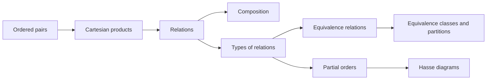
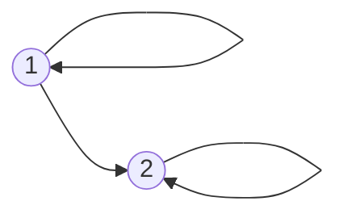
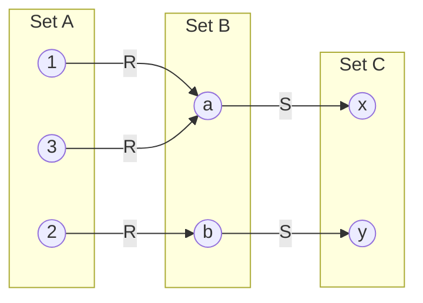
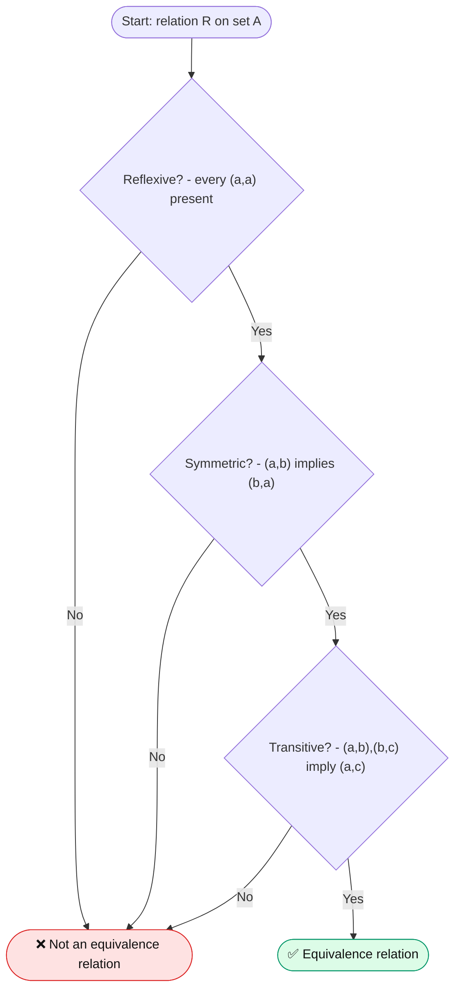
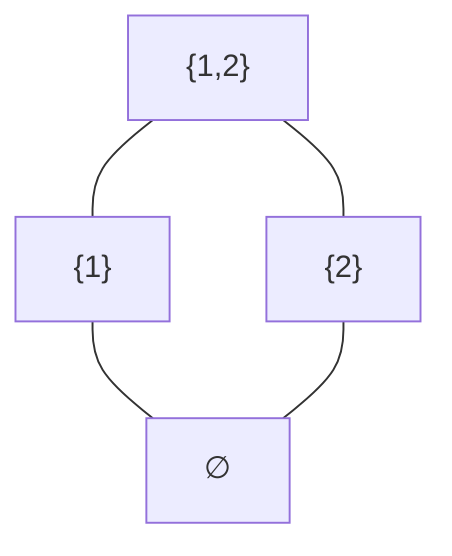
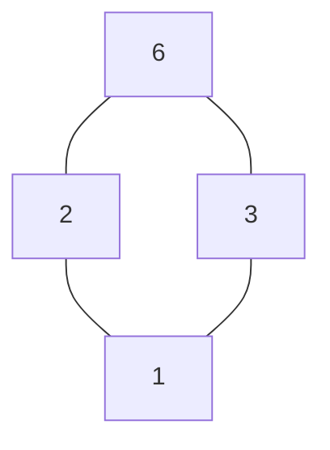

# 📐 Relations

### Discrete Mathematics · Lecture Notes

*Product sets · Relations · Composition · Types of relations · Equivalence relations · Partial orders*

---

> [!NOTE]
> These notes cover the chapter in a structured, classroom-ready format with **definitions**, **explanations**, **worked examples**, **diagrams**, **summary tables**, and **practice questions**.

## 🗺️ Chapter Roadmap

## 📑 Table of Contents

| # | Section | Key ideas |
|:-:|:--|:--|
| 1 | [Introduction to Relations](#sec1) | Ordered pairs, relation vs. function |
| 2 | [Product Sets](#sec2) | Cartesian product, cardinality, properties |
| 3 | [Relations](#sec3) | Definition, domain/range, inverse, representations |
| 4 | [Composition of Relations](#sec4) | $S\circ R$, associativity, common mistakes |
| 5 | [Types of Relations](#sec5) | Reflexive, symmetric, antisymmetric, transitive, … |
| 6 | [Equivalence Relations](#sec6) | Equivalence classes and partitions |
| 7 | [Partial Ordering Relations](#sec7) | Posets, comparability, Hasse diagrams |
| 8 | [Summary of Important Concepts](#sec8) | Cheat-sheet and property matrix |
| 9 | [Solved Revision Questions](#sec9) | Step-by-step solutions |
| 10 | [Practice Exercises](#sec10) | Self-test with hidden answers |
| 11 | [Teaching Sequence](#sec11) | Suggested lecture plan |

---

## 🎯 Learning Objectives

After studying this chapter, students should be able to:

- [ ] Understand ordered pairs and Cartesian products.
- [ ] Define relations and identify their domain, codomain, and range.
- [ ] Represent relations using ordered pairs, matrices, and directed graphs.
- [ ] Calculate the composition of two relations.
- [ ] Identify and verify different types of relations.
- [ ] Determine whether a relation is an equivalence relation.
- [ ] Understand partial orders, comparable elements, and Hasse diagrams.

---

## 📘 1. Introduction to Relations

### 1.1 What Is a Relation?

> [!NOTE]
> **Definition — Relation.** A **relation** describes a connection between elements of one set and elements of another set, or between elements of the same set.

For example, consider:

$$
A=\lbrace 1,2,3 \rbrace, \qquad B=\lbrace 2,4,6 \rbrace
$$

Define a relationship from $A$ to $B$ by the rule “$b$ is twice $a$.” Then

$$
R=\lbrace (1,2),(2,4),(3,6) \rbrace
$$

Each ordered pair represents a connection between two elements. We write $aRb$ to mean that $a$ is related to $b$ under relation $R$.

### 1.2 Ordered Pairs

An ordered pair is written as $(a,b)$, where the order of the elements matters. In general,

$$
(2,3)\ne(3,2)
$$

Two ordered pairs are equal exactly when their corresponding components are equal:

$$
(a,b)=(c,d)\iff a=c\text{ and }b=d
$$

**Example:** If $(x,5)=(3,y)$, then $x=3$ and $y=5$.

### 1.3 Relation Versus Function

A function is a special type of relation.

| Relation | Function |
|---|---|
| An element may be related to zero, one, or several elements. | Every element of the domain must be related to exactly one output. |
| Multiple outputs for one input are allowed. | Multiple outputs for one input are not allowed. |
| Some domain elements may have no related output. | No domain element can be left without an output. |

For example, $R=\lbrace (1,a),(1,b),(2,a) \rbrace$ is a relation but is not a function from $\lbrace 1,2 \rbrace$ to $\lbrace a,b \rbrace$, because input $1$ has two outputs.

---

## 🧮 2. Product Sets

### 2.1 Cartesian Product

> [!NOTE]
> **Definition — Cartesian product.** The **Cartesian product** of two sets $A$ and $B$, denoted by $A\times B$, is the set of all ordered pairs whose first element belongs to $A$ and second element belongs to $B$.

$$
A\times B=\lbrace (a,b)\mid a\in A,\enspace b\in B \rbrace
$$

### 2.2 Worked Example

Let

$$
A=\lbrace 1,2 \rbrace,\qquad B=\lbrace x,y \rbrace
$$

Then

$$
A\times B=\lbrace (1,x),(1,y),(2,x),(2,y) \rbrace
$$

Similarly,

$$
B\times A=\lbrace (x,1),(x,2),(y,1),(y,2) \rbrace
$$

Notice that $A\times B\ne B\times A$ in this example.

### 2.3 Cardinality of a Cartesian Product

If $A$ and $B$ are finite sets, then

$$
|A\times B|=|A|\times|B|
$$

**Example:** If $\vert A\vert =3$ and $\vert B\vert =4$, then

$$
|A\times B|=3\times4=12
$$

### 2.4 Important Properties

1. In general, $A\times B\ne B\times A$.
2. $A\times\varnothing=\varnothing$.
3. $\varnothing\times A=\varnothing$.
4. $A\times(B\cup C)=(A\times B)\cup(A\times C)$.
5. If $A$ and $B$ are non-empty, then $A\times B$ is non-empty.

### 2.5 Product of Three Sets

For three sets $A$, $B$, and $C$,

$$
A\times B\times C
=\lbrace (a,b,c)\mid a\in A,\enspace b\in B,\enspace c\in C \rbrace
$$

If the sets have 2, 3, and 4 elements respectively, the product contains $2\times3\times4=24$ ordered triples.

---

## 🔗 3. Relations

### 3.1 Definition

> [!NOTE]
> **Definition — Binary relation.** A **binary relation** $R$ from set $A$ to set $B$ is any subset of the Cartesian product $A\times B$:

$$
R\subseteq A\times B
$$

A relation **on** a set $A$ is a subset of $A\times A$:

$$
R\subseteq A\times A
$$

### 3.2 Example of a Relation Between Two Sets

Let

$$
A=\lbrace 1,2,3 \rbrace,\quad B=\lbrace 2,4,6 \rbrace
$$

Define $R$ by $aRb$ if and only if $b=2a$. Then

$$
R=\lbrace (1,2),(2,4),(3,6) \rbrace
$$

The relation is a subset of $A\times B$, not necessarily the entire Cartesian product.

### 3.3 Domain, Codomain, and Range

Consider

$$
R=\lbrace (1,a),(2,b),(3,b) \rbrace
$$

from $A=\lbrace 1,2,3 \rbrace$ to $B=\lbrace a,b,c \rbrace$.

- **Domain of the relation:** the set of first components, $\lbrace 1,2,3 \rbrace$.
- **Codomain:** the target set $B=\lbrace a,b,c \rbrace$.
- **Range:** the set of second components that occur, $\lbrace a,b \rbrace$.

The range is always a subset of the codomain.

### 3.4 Inverse Relation

The inverse relation $R^{-1}$ is obtained by reversing each ordered pair.

If

$$
R=\lbrace (1,a),(2,b),(3,b) \rbrace
$$

then

$$
R^{-1}=\lbrace (a,1),(b,2),(b,3) \rbrace
$$

For a relation from $A$ to $B$, the inverse relation goes from $B$ to $A$.

### 3.5 Representing Relations

Relations can be represented in three common ways:

- **Ordered pairs:** $R=\lbrace (1,1),(1,2),(2,2) \rbrace$.
- **Matrix:** use a 1 when a pair belongs to the relation and a 0 otherwise.
- **Directed graph:** represent elements as vertices and pairs as directed edges.

**Example:** Let $A=\lbrace 1,2 \rbrace$ and $R=\lbrace (1,1),(1,2),(2,2) \rbrace$. Its matrix, with rows and columns ordered as $1,2$, is

$$
M_R=\begin{bmatrix}1&1\\0&1\end{bmatrix}
$$

The graph has a loop at 1, an arrow from 1 to 2, and a loop at 2.

### 3.6 Number of Relations

If $A$ has $n$ elements, then $A\times A$ contains $n^2$ ordered pairs. Every subset of $A\times A$ is a relation on $A$.

Therefore, the total number of relations on $A$ is

$$
\boxed{2^{n^2}}
$$

**Example:** If $A=\lbrace 1,2 \rbrace$, there are four possible ordered pairs in $A\times A$, so there are $2^4=16$ relations on $A$.

---

## 🔄 4. Composition of Relations

### 4.1 Definition

> [!NOTE]
> **Definition — Composition.** The **composition of relations** combines two relations to establish a connection between the starting element of the first relation and the ending element of the second relation.

Suppose:

- $R$ is a relation from $A$ to $B$.
- $S$ is a relation from $B$ to $C$.

Their composition, denoted by $S\circ R$, is a relation from $A$ to $C$:

$$
S\circ R=\lbrace (a,c)\mid
\exists b\in B,\enspace (a,b)\in R\text{ and }(b,c)\in S \rbrace
$$

In simple terms, if $a$ is related to $b$ by $R$, and $b$ is related to $c$ by $S$, then $a$ is related to $c$ by $S\circ R$.

> [!IMPORTANT]
> In $S\circ R$, apply $R$ **first** and then $S$ — read it from right to left.

### 4.2 Worked Example

Let

$$
A=\lbrace 1,2,3 \rbrace,\quad B=\lbrace a,b \rbrace,\quad C=\lbrace x,y \rbrace
$$

Suppose

$$
R=\lbrace (1,a),(2,b),(3,a) \rbrace
$$

and

$$
S=\lbrace (a,x),(b,y) \rbrace
$$

Follow the connections through the common set $B$:

- $1\to a\to x$, so $(1,x)$ belongs to the composition.
- $2\to b\to y$, so $(2,y)$ belongs to the composition.
- $3\to a\to x$, so $(3,x)$ belongs to the composition.

Hence,

$$
\boxed{S\circ R=\lbrace (1,x),(2,y),(3,x) \rbrace}
$$

### 4.3 Numerical Example

Let

$$
R=\lbrace (1,2),(2,3) \rbrace
$$

and

$$
S=\lbrace (2,4),(3,5) \rbrace
$$

The paths $1\to2\to4$ and $2\to3\to5$ produce

$$
\boxed{S\circ R=\lbrace (1,4),(2,5) \rbrace}
$$

### 4.4 Properties of Composition

**Associativity:** For compatible relations $R,S,T$,

$$
T\circ(S\circ R)=(T\circ S)\circ R
$$

**Not necessarily commutative:** In general,

$$
S\circ R\ne R\circ S
$$

**Identity relation:** For a set $A$,

$$
I_A=\lbrace (a,a)\mid a\in A \rbrace
$$

For a relation $R$ on $A$,

$$
R\circ I_A=I_A\circ R=R
$$

### 4.5 Common Mistakes

> [!WARNING]
> Watch out for these frequent errors:
>
> - ❌ Reversing the order of composition.
> - ❌ Joining pairs whose middle elements do not match.
> - ❌ Including a pair without a valid connecting path.
> - ❌ Confusing composition with intersection or union.

---

## 🏷️ 5. Types of Relations

Relations can be classified according to their properties. These properties are usually tested for relations on a set $A$. Consider $A=\lbrace 1,2,3 \rbrace$.

### 5.1 Empty Relation

A relation with no ordered pairs is called an empty relation:

$$
R=\varnothing
$$

For example, the relation defined by $a>10b$ is empty if $a,b\in\lbrace 1,2,3 \rbrace$.

### 5.2 Universal Relation

The universal relation on $A$ contains every ordered pair in $A\times A$:

$$
R=A\times A
$$

For $A=\lbrace 1,2 \rbrace$,

$$
R=\lbrace (1,1),(1,2),(2,1),(2,2) \rbrace
$$

### 5.3 Identity Relation

The identity relation contains only pairs whose components are equal:

$$
I_A=\lbrace (a,a)\mid a\in A \rbrace
$$

For $A=\lbrace 1,2,3 \rbrace$,

$$
I_A=\lbrace (1,1),(2,2),(3,3) \rbrace
$$

### 5.4 Reflexive Relation

A relation $R$ on $A$ is reflexive if every element is related to itself:

$$
\forall a\in A,\quad (a,a)\in R
$$

**Example:**

$$
R=\lbrace (1,1),(2,2),(3,3),(1,2) \rbrace
$$

This relation is reflexive because all three diagonal pairs are present.

If any required pair such as $(2,2)$ is missing, the relation is not reflexive.

### 5.5 Irreflexive Relation

A relation $R$ is irreflexive if no element is related to itself:

$$
\forall a\in A,\quad (a,a)\notin R
$$

**Example:** The less-than relation $<$ on the integers is irreflexive because $a<a$ is never true.

### 5.6 Symmetric Relation

A relation $R$ is symmetric if

$$
(a,b)\in R\implies(b,a)\in R
$$

**Example:**

$$
R=\lbrace (1,1),(2,2),(1,2),(2,1) \rbrace
$$

This relation is symmetric because both $(1,2)$ and $(2,1)$ are included.

**Real-life example:** “Has the same age as” is symmetric.

### 5.7 Antisymmetric Relation

A relation $R$ is antisymmetric if

$$
(a,b)\in R\text{ and }(b,a)\in R\implies a=b
$$

Two distinct elements cannot be related in both directions.

**Example:** The relation $\leq$ on integers is antisymmetric. If $a\leq b$ and $b\leq a$, then $a=b$.

> [!NOTE]
> Antisymmetric does **not** mean that reverse pairs are always absent. Self-pairs $(a,a)$ are allowed.

### 5.8 Asymmetric Relation

A relation $R$ is asymmetric if

$$
(a,b)\in R\implies(b,a)\notin R
$$

An asymmetric relation is necessarily irreflexive.

**Example:** The less-than relation $<$ is asymmetric. If $2<3$, then $3<2$ is false.

### 5.9 Transitive Relation

A relation $R$ is transitive if

$$
(a,b)\in R\text{ and }(b,c)\in R\implies(a,c)\in R
$$

**Example:**

$$
R=\lbrace (1,2),(2,3),(1,3) \rbrace
$$

This relation is transitive because the first two pairs require $(1,3)$, which is present.

**Counterexample:**

$$
R=\lbrace (1,2),(2,3) \rbrace
$$

This relation is not transitive on $\lbrace 1,2,3 \rbrace$, because $(1,3)$ is missing.

### 5.10 Comparison Table

| Type | Condition | Example |
|---|---|---|
| Reflexive | Every $(a,a)$ is present | $\leq$ |
| Irreflexive | No $(a,a)$ is present | $<$ |
| Symmetric | $aRb\Rightarrow bRa$ | Equality |
| Antisymmetric | $aRb\land bRa\Rightarrow a=b$ | $\leq$ |
| Asymmetric | $aRb\Rightarrow\neg(bRa)$ | $<$ |
| Transitive | $aRb\land bRc\Rightarrow aRc$ | $\leq$ |

A relation can have more than one property. For example, the identity relation is reflexive, symmetric, antisymmetric, and transitive.

### 5.11 Practice Example

Let

$$
A=\lbrace 1,2 \rbrace,\quad R=\lbrace (1,1),(2,2),(1,2) \rbrace
$$

- **Reflexive:** Yes, because $(1,1)$ and $(2,2)$ are present.
- **Symmetric:** No, because $(1,2)$ is present but $(2,1)$ is absent.
- **Antisymmetric:** Yes, because there are no opposite pairs between distinct elements.
- **Transitive:** Yes. All required pairs produced by two-step paths are already in $R$.

Thus, $R$ is reflexive, antisymmetric, and transitive, but not symmetric.

---

## ⚖️ 6. Equivalence Relations

### 6.1 Definition

> [!NOTE]
> **Definition — Equivalence relation.** An **equivalence relation** is a relation that satisfies all three properties:
>
> 1. Reflexive
> 2. Symmetric
> 3. Transitive

For all $a,b,c\in A$,

$$
\begin{aligned}
&\text{Reflexive:} &&aRa\\
&\text{Symmetric:} &&aRb\implies bRa\\
&\text{Transitive:} &&aRb\land bRc\implies aRc
\end{aligned}
$$

> [!IMPORTANT]
> All three conditions are necessary — failing even one means the relation is **not** an equivalence relation.

### 6.2 Worked Example: Congruence Modulo 3

Let $A=\lbrace 1,2,3,4,5,6 \rbrace$. Define a relation $R$ by

$$
aRb\iff a\equiv b\pmod 3
$$

This means that $a$ and $b$ leave the same remainder when divided by 3.

The relation is

$$
\begin{aligned}
R=\lbrace &(1,1),(1,4),(4,1),(4,4),\\
&(2,2),(2,5),(5,2),(5,5),\\
&(3,3),(3,6),(6,3),(6,6) \rbrace
\end{aligned}
$$

**Property 1: Reflexive**

Every integer has the same remainder as itself:

$$
a\equiv a\pmod 3
$$

Therefore, $R$ is reflexive.

**Property 2: Symmetric**

If $a$ and $b$ leave the same remainder, then $b$ and $a$ also leave the same remainder:

$$
a\equiv b\pmod 3\implies b\equiv a\pmod 3
$$

Therefore, $R$ is symmetric.

**Property 3: Transitive**

If $a$ and $b$ have the same remainder, and $b$ and $c$ have the same remainder, then $a$ and $c$ have the same remainder:

$$
a\equiv b\pmod 3,\quad b\equiv c\pmod 3
\implies a\equiv c\pmod 3
$$

Therefore, $R$ is transitive.

Hence, $\boxed{R\text{ is an equivalence relation}}$.

### 6.3 Equivalence Classes

An **equivalence class** of an element $a$ is the set of all elements related to $a$:

$$
[a]=\lbrace x\in A\mid xRa \rbrace
$$

For the modulo 3 example, the equivalence classes are:

$$
[1]=\lbrace 1,4 \rbrace,\quad [2]=\lbrace 2,5 \rbrace,\quad [3]=\lbrace 3,6 \rbrace
$$

These classes group the elements according to their remainders.

### 6.4 Properties of Equivalence Classes

For an equivalence relation:

- Every element belongs to its own equivalence class.
- Two equivalence classes are either equal or disjoint.
- The union of all distinct equivalence classes is the original set.
- Equivalence classes form a partition of the set.

A **partition** is a collection of non-empty, pairwise disjoint subsets whose union is the entire set.

### 6.5 Real-Life Examples

**Example 1: Same birthday month**

Define $aRb$ if students $a$ and $b$ were born in the same month.

- Reflexive: Every student has the same birth month as themselves.
- Symmetric: If A has the same birth month as B, B has the same birth month as A.
- Transitive: If A and B share a birth month, and B and C share a birth month, A and C share that month.

Therefore, this is an equivalence relation.

**Example 2: Same remainder**

For integers, define $aRb$ if $a-b$ is divisible by 5. This is also an equivalence relation.

### 6.6 Example That Is Not an Equivalence Relation

Let $A=\lbrace 1,2,3 \rbrace$ and

$$
R=\lbrace (1,1),(2,2),(3,3),(1,2) \rbrace
$$

This relation is reflexive but not symmetric because $(1,2)\in R$ while $(2,1)\notin R$.

Therefore, it is **not** an equivalence relation.

### 6.7 How to Test an Equivalence Relation

---

## 📶 7. Partial Ordering Relations

### 7.1 Definition

> [!NOTE]
> **Definition — Partial order.** A **partial order relation** satisfies three properties:
>
> 1. Reflexive
> 2. Antisymmetric
> 3. Transitive
>
> A set together with a partial order is called a **partially ordered set**, or **poset**.

If $R$ is a partial order on $A$, then

$$
\begin{aligned}
&\text{Reflexive:} &&aRa\\
&\text{Antisymmetric:} &&aRb\land bRa\implies a=b\\
&\text{Transitive:} &&aRb\land bRc\implies aRc
\end{aligned}
$$

Symmetry is not required.

### 7.2 Example: Less Than or Equal To

Let $A=\lbrace 1,2,3 \rbrace$ and define $R$ by $aRb$ if $a\leq b$. Then

$$
\begin{aligned}
R=\lbrace &(1,1),(2,2),(3,3),\\
&(1,2),(1,3),(2,3) \rbrace
\end{aligned}
$$

Check the properties:

- **Reflexive:** $1\leq1$, $2\leq2$, and $3\leq3$.
- **Antisymmetric:** If $a\leq b$ and $b\leq a$, then $a=b$.
- **Transitive:** If $a\leq b$ and $b\leq c$, then $a\leq c$.

Therefore, $\leq$ is a partial order.

### 7.3 Partial Order Versus Total Order

In a partial order, some elements may not be comparable. In a total order, every pair of elements must be comparable.

Elements $a$ and $b$ are comparable if either $aRb$ or $bRa$.

| Partial Order | Total Order |
|---|---|
| Reflexive, antisymmetric, and transitive | Reflexive, antisymmetric, transitive, and every pair is comparable |
| Some pairs may be incomparable | No incomparable pairs |
| Example: set inclusion $\subseteq$ | Example: $\leq$ on integers |

### 7.4 Example: Subset Relation

Let

$$
A=\lbrace \varnothing,\lbrace 1 \rbrace,\lbrace 2 \rbrace,\lbrace 1,2 \rbrace \rbrace
$$

Define the relation $\subseteq$ on these subsets.

The relation is a partial order because:

- Every set is a subset of itself.
- If $X\subseteq Y$ and $Y\subseteq X$, then $X=Y$.
- If $X\subseteq Y$ and $Y\subseteq Z$, then $X\subseteq Z$.

However, $\lbrace 1 \rbrace$ and $\lbrace 2 \rbrace$ are incomparable because neither is a subset of the other.

Hence, $\subseteq$ is a partial order but not a total order on this collection.

### 7.5 Hasse Diagrams

A **Hasse diagram** is a simplified graphical representation of a finite partially ordered set.

Conventions:

- Larger elements are generally drawn higher when they are greater under the order.
- Self-loops are omitted.
- Edges implied by transitivity are omitted.

For the subset relation on the subsets of $\lbrace 1,2 \rbrace$:

The diagram shows:

$$
\varnothing\subseteq\lbrace 1 \rbrace,\quad
\varnothing\subseteq\lbrace 2 \rbrace
$$

and

$$
\lbrace 1 \rbrace\subseteq\lbrace 1,2 \rbrace,\quad
\lbrace 2 \rbrace\subseteq\lbrace 1,2 \rbrace
$$

The direct edges from $\varnothing$ to $\lbrace 1,2 \rbrace$ are omitted because those relationships are implied by transitivity.

### 7.6 Maximum, Minimum, Maximal, and Minimal Elements

These concepts are related but are not interchangeable.

- **Maximum element:** an element greater than or equal to every element in the poset.
- **Minimum element:** an element less than or equal to every element in the poset.
- **Maximal element:** an element for which no distinct element is strictly greater.
- **Minimal element:** an element for which no distinct element is strictly smaller.

In the Hasse diagram above:

- Maximum element: $\lbrace 1,2 \rbrace$.
- Minimum element: $\varnothing$.
- Both maximal and minimal elements are unique in this example.

A poset may have several maximal or minimal elements, and it may have no maximum or minimum.

### 7.7 Example: Divisibility

Let $A=\lbrace 1,2,3,6 \rbrace$, and define $aRb$ if $a$ divides $b$.

We write $a\mid b$ when $b=ak$ for some integer $k$.

For example, $2\mid6$, because $6=2\times3$.

The relation is a partial order:

- **Reflexive:** Every positive integer divides itself.
- **Antisymmetric:** If $a\mid b$ and $b\mid a$, for positive integers $a,b$, then $a=b$.
- **Transitive:** If $a\mid b$ and $b\mid c$, then $a\mid c$.

In this example, 2 and 3 are incomparable: neither divides the other.

Its Hasse diagram:

### 7.8 Equivalence Relation Versus Partial Order

| Feature | Equivalence Relation | Partial Order |
|:--|:-:|:-:|
| Reflexive | ✅ Required | ✅ Required |
| Symmetric | ✅ Required | ➖ Not required |
| Antisymmetric | ➖ Not required | ✅ Required |
| Transitive | ✅ Required | ✅ Required |
| Main purpose | Groups equivalent elements | Arranges elements by an ordering rule |
| Typical example | Congruence modulo $n$ | Subset inclusion |

> [!TIP]
> **Key observation.** A relation that is both symmetric and antisymmetric can contain only pairs of the form $(a,a)$. If it is also reflexive, it must be the identity relation. The identity relation is therefore both an equivalence relation and a partial order.

---

## 📊 8. Summary of Important Concepts

| Concept | Definition or Condition |
|---|---|
| Cartesian product | $A\times B=\lbrace (a,b):a\in A,b\in B \rbrace$ |
| Binary relation | Any subset of $A\times B$ |
| Inverse relation | $R^{-1}=\lbrace (b,a):(a,b)\in R \rbrace$ |
| Composition | Join pairs through a common middle element |
| Reflexive | $aRa$ for every $a$ |
| Symmetric | $aRb\Rightarrow bRa$ |
| Antisymmetric | $aRb\land bRa\Rightarrow a=b$ |
| Transitive | $aRb\land bRc\Rightarrow aRc$ |
| Equivalence relation | Reflexive + symmetric + transitive |
| Partial order | Reflexive + antisymmetric + transitive |
| Poset | A set equipped with a partial order |
| Hasse diagram | Simplified diagram of a finite poset |

### 8.1 Property Matrix for Common Relations

| Relation | Reflexive | Symmetric | Antisymmetric | Transitive | Classification |
|:--|:-:|:-:|:-:|:-:|:--|
| Equality $=$ | ✅ | ✅ | ✅ | ✅ | Equivalence **and** partial order |
| Congruence mod $n$ | ✅ | ✅ | ❌* | ✅ | Equivalence relation |
| Less than or equal $\leq$ | ✅ | ❌ | ✅ | ✅ | Partial (total) order |
| Subset $\subseteq$ | ✅ | ❌ | ✅ | ✅ | Partial order |
| Divides $\mid$ | ✅ | ❌ | ✅ | ✅ | Partial order |
| Less than $<$ | ❌ | ❌ | ✅ | ✅ | Strict order (irreflexive, asymmetric) |

\*Antisymmetry fails whenever the set contains two distinct elements that are congruent.

---

## ✍️ 9. Solved Revision Questions

### Question 1: Find the Cartesian Product

Let $A=\lbrace 1,2 \rbrace$ and $B=\lbrace a,b,c \rbrace$. Find $A\times B$ and its cardinality.

**Solution:**

$$
\begin{aligned}
A\times B=\lbrace &(1,a),(1,b),(1,c),\\
&(2,a),(2,b),(2,c) \rbrace
\end{aligned}
$$

Therefore,

$$
|A\times B|=2\times3=\boxed{6}
$$

### Question 2: Determine Whether a Relation Is Reflexive

Let $A=\lbrace 1,2,3 \rbrace$ and

$$
R=\lbrace (1,1),(2,2),(3,3),(1,2) \rbrace
$$

Is $R$ reflexive?

**Solution:** Yes. The required pairs $(1,1),(2,2),(3,3)$ are all present. Hence, $R$ is reflexive.

### Question 3: Find a Composition of Relations

Let

$$
R=\lbrace (1,2),(2,3) \rbrace
$$

and

$$
S=\lbrace (2,4),(3,5) \rbrace
$$

Find $S\circ R$.

**Solution:** The paths are $1\to2\to4$ and $2\to3\to5$. Therefore,

$$
\boxed{S\circ R=\lbrace (1,4),(2,5) \rbrace}
$$

### Question 4: Check Whether a Relation Is an Equivalence Relation

Let $A=\lbrace 1,2,3 \rbrace$ and

$$
R=\lbrace (1,1),(2,2),(3,3),(1,2),(2,1) \rbrace
$$

**Solution:**

- Reflexive: Yes, all diagonal pairs are present.
- Symmetric: Yes, $(1,2)$ and $(2,1)$ are both present.
- Transitive: Yes. The nontrivial two-step paths involving distinct elements are $1\to2\to1$ and $2\to1\to2$, and the required pairs $(1,1)$ and $(2,2)$ are present.

Therefore, $R$ is an equivalence relation.

Its equivalence classes are

$$
[1]=[2]=\lbrace 1,2 \rbrace,\qquad [3]=\lbrace 3 \rbrace
$$

### Question 5: Check Whether Divisibility Is a Partial Order

Consider the relation $aRb$ if $a\mid b$, on the positive integers.

**Solution:**

- Reflexive: $a\mid a$.
- Antisymmetric: If $a\mid b$ and $b\mid a$, then $a=b$.
- Transitive: If $a\mid b$ and $b\mid c$, then $a\mid c$.

Therefore, divisibility on the positive integers is a partial order.

---

## 🏋️ 10. Practice Exercises for Students

Attempt each question before checking the answer.

<strong>Question 1: Cartesian product</strong>

Let $A=\lbrace 1,2 \rbrace$ and $B=\lbrace x,y,z \rbrace$. Write $A\times B$ and calculate its cardinality.

**Answer:**

$$
A\times B=\lbrace (1,x),(1,y),(1,z),(2,x),(2,y),(2,z) \rbrace
$$

Its cardinality is $2\times3=6$.

<strong>Question 2: Reflexivity</strong>

Let $A=\lbrace 1,2,3 \rbrace$ and $R=\lbrace (1,1),(2,2),(1,2),(2,1) \rbrace$. Is $R$ reflexive?

**Answer:** No. The pair $(3,3)$ is missing, so $R$ is not reflexive on $A$.

<strong>Question 3: Composition</strong>

If $R=\lbrace (1,2),(2,3) \rbrace$ and $S=\lbrace (2,4),(3,5) \rbrace$, find $S\circ R$.

**Answer:**

$$
S\circ R=\lbrace (1,4),(2,5) \rbrace
$$

<strong>Question 4: Symmetric but not reflexive</strong>

Give an example of a relation that is symmetric but not reflexive.

**Answer:** On $A=\lbrace 1,2 \rbrace$, take $R=\lbrace (1,2),(2,1) \rbrace$. It is symmetric, but neither $(1,1)$ nor $(2,2)$ is present.

<strong>Question 5: Partial order</strong>

Explain why the relation $\leq$ on integers is a partial order.

**Answer:** It is reflexive, antisymmetric, and transitive.

<strong>Question 6: Equivalence classes</strong>

Define an equivalence class and give an example using congruence modulo 2 on $\lbrace 1,2,3,4 \rbrace$.

**Answer:** An equivalence class contains all elements related to a chosen element. The distinct classes are $\lbrace 1,3 \rbrace$ and $\lbrace 2,4 \rbrace$.

<strong>Question 7: Hasse diagram</strong>

What is a Hasse diagram? Why are some edges omitted?

**Answer:** A Hasse diagram represents a finite poset. Self-loops and edges implied by transitivity are omitted.

<strong>Question 8: Both equivalence and partial order</strong>

Can a relation be both an equivalence relation and a partial order? Explain.

**Answer:** Yes. The identity relation is both: it is reflexive, symmetric, antisymmetric, and transitive.

---

## 🗓️ 11. Suggested Classroom Teaching Sequence

| Session | Focus |
|:-:|:--|
| **Lecture 1** | Ordered pairs, Cartesian products, and definitions of relations |
| **Lecture 2** | Domain, range, inverse relations, and representations |
| **Lecture 3** | Composition of relations and numerical examples |
| **Lecture 4** | Reflexive, symmetric, antisymmetric, asymmetric, and transitive relations |
| **Lecture 5** | Equivalence relations, equivalence classes, and partitions |
| **Lecture 6** | Partial orders, comparability, and Hasse diagrams |
| **Tutorial** | Property-testing problems, composition exercises, and equivalence-class questions |

## 💡 Final Takeaway

> [!TIP]
> The central idea of this chapter is that **relations describe connections between elements, while their properties determine the mathematical structure of those connections**.
>
> - 🟢 **Equivalence relations** group elements into classes.
> - 🟠 **Partial orders** organize elements according to an ordering rule.
>
> These concepts form the foundation for later topics in discrete mathematics, graph theory, databases, algorithms, and computer science.

---

**✨ End of Lecture Notes ✨**

